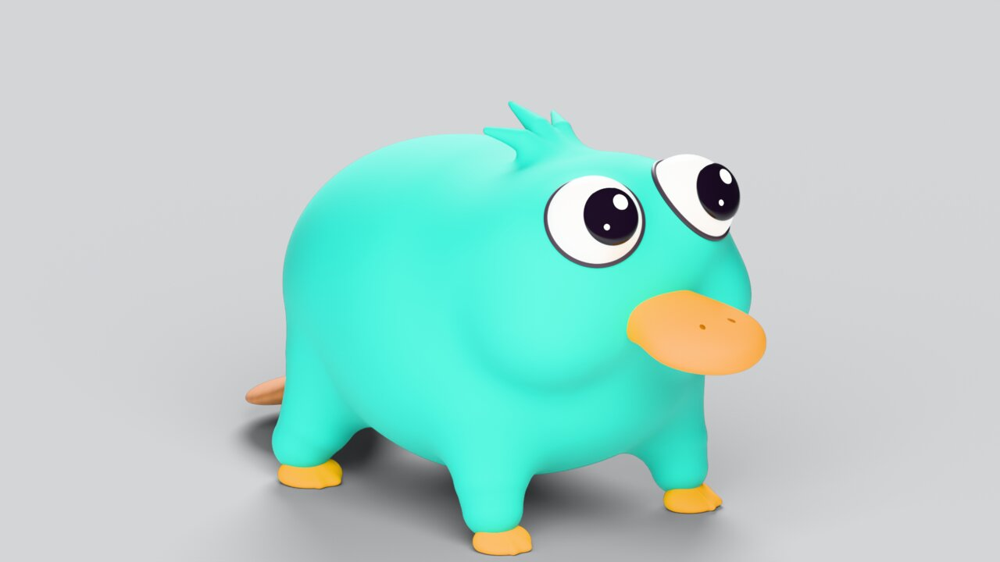
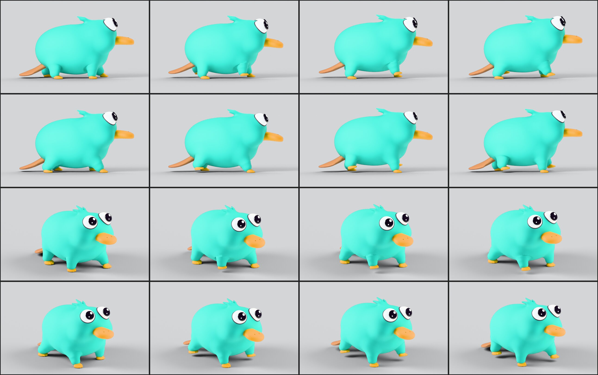

# Ornitorrinco Gordito

Personaje 3D caricaturesco con esqueleto y animaciones, listo para web. Lo puedes mover por un patio en el navegador.

**Demo:** https://mespinoza03.github.io/ornitorrinco-gordito/



## Controles

| Acción | Teclado | Táctil |
|---|---|---|
| Caminar (relativo a la cámara) | `W` `A` `S` `D` o flechas | Joystick abajo a la izquierda |
| Trotar | mantener `Shift` | Botón **Trotar** |
| Mover la cámara | arrastrar en la escena | arrastrar en la escena |
| Vistas fijas | botones Tres cuartos / Frente / Lado / Atrás | igual |

Haz clic en la escena antes de usar el teclado.

## Modelo

| | |
|---|---|
| Archivo | [`modelo/ornitorrinco_animado.glb`](modelo/ornitorrinco_animado.glb) (269 KB, Draco) |
| Sin animación | [`modelo/ornitorrinco_estatico.glb`](modelo/ornitorrinco_estatico.glb) (187 KB, Draco) |
| Medidas | 1,48 × 0,70 × 0,81 m (largo × ancho × alto), 1 unidad = 1 m |
| Geometría | 66 304 triángulos, 19 mallas, 9 materiales PBR |
| Esqueleto | 14 huesos (raíz, cuerpo, panza, cabeza, 4 patas, 4 pies, 2 de cola) |
| Animaciones | `Reposo` (2,4 s) y `Caminar` (0,8 s), ambas en bucle y en el sitio |
| Velocidad al paso | 0,342 m/s: a `timeScale = 1` el pie apoyado no patina |
| Orientación | frente +Z, arriba +Y (glTF estándar) |



### Usarlo en three.js

```js
import { GLTFLoader } from 'three/addons/loaders/GLTFLoader.js';
import { DRACOLoader } from 'three/addons/loaders/DRACOLoader.js';

const draco = new DRACOLoader();
draco.setDecoderPath('https://cdn.jsdelivr.net/npm/three@0.169.0/examples/jsm/libs/draco/gltf/');
const loader = new GLTFLoader().setDRACOLoader(draco);

loader.load('modelo/ornitorrinco_animado.glb', gltf => {
  scene.add(gltf.scene);
  const mixer = new THREE.AnimationMixer(gltf.scene);
  const walk = mixer.clipAction(THREE.AnimationClip.findByName(gltf.animations, 'Caminar'));
  walk.play();
  // en el bucle: mixer.update(dt); y desplaza el modelo a 0.342 m/s × walk.timeScale
});
```

Usa `renderer.toneMapping = THREE.NeutralToneMapping` para ver los colores como en los renders (Khronos PBR Neutral).

## Cómo se hizo

Modelado y animado por script en Blender 5.3 (bpy, sin interfaz):

- El cuerpo, la cabeza, las patas y el mechón son una sola superficie continua: un campo de distancia con uniones suaves, convertido en malla con *surface nets* y reducido a 36 000 triángulos para web.
- El pico, la cola y los pies son mallas construidas por secciones. Los ojos llevan globo, pupila convexa, reflejos y un contorno calculado sobre la línea donde el globo sale de la piel.
- La caminata es un trote en diagonal. La altura de cada pata se calcula en cada fotograma para que la planta quede en el suelo (0 mm de hundimiento).

La página es un solo `index.html` con three.js 0.169 desde jsDelivr; no necesita compilar nada.
